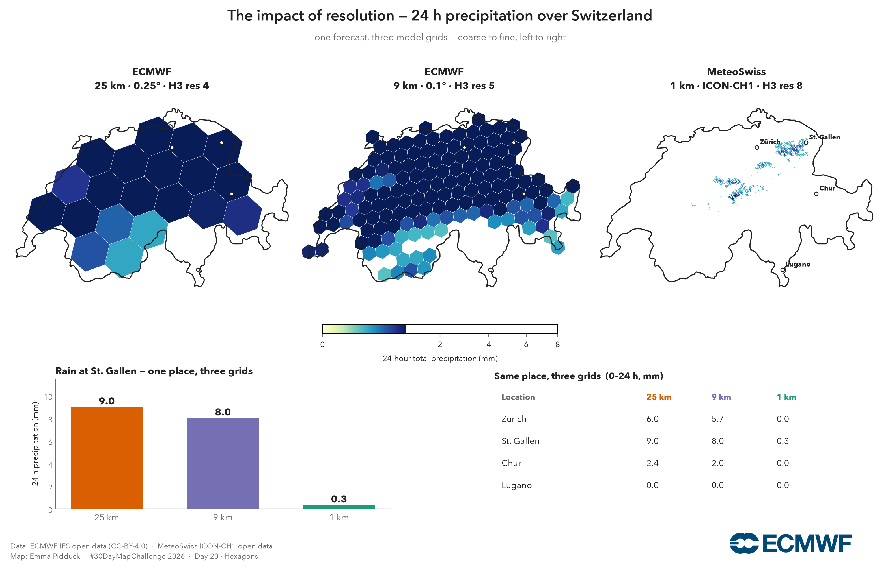

# Weather Maps · #30DayMapChallenge 2026

Beautiful, reproducible weather maps built on **open data** — from ECMWF's global forecasts
(9 km and 25 km) to MeteoSwiss's 1 km Alpine model — using ECMWF's own open-source Python tools.

Every map is a **self-contained Jupyter notebook**: method, code, output, data licence and
tools in one place. Nothing to install beyond `pip`; nothing hidden.

> ⚠️ **Just for fun — not an official ECMWF product.** Claude (Anthropic) helped build these
> notebooks. They are **not** official ECMWF notebooks and are **not** supported by ECMWF — a
> personal #30DayMapChallenge experiment to show how approachable open weather data has become.

## The maps

- **[Day 2 · Lines](day02_lines_jet)** — the jet stream as 250 hPa wind, drawn as flowing streamlines.
- **[Day 6 · Vintage](day06_vintage)** — today's mean-sea-level pressure as a mid-century surface
  analysis chart: sepia isobars, hand-marked highs and lows, on aged paper.
- **[Day 20 · Hexagons](day20_hexagons)** — one forecast on three model grids (25 → 9 → 1 km),
  binned into hexagons, so you can *see* what resolution buys you.
- **[Day 22 · Projections](day22_projections)** — one 500 hPa height field on four projections,
  so the distortion every flat map makes becomes visible in the graticule.
- **[Day 26 · Water](day26_water_vapour)** — total-column water vapour as an orthographic globe:
  the atmospheric rivers that carry more water than the Amazon, drawn on the sphere.
- **[Day 27 · New tool](day27_new_tool_zarr)** — the Great Storm of 1987, pulled live from the
  ERA5 reanalysis as cloud-native **Zarr** (ARCO-ERA5): one hour out of 60+ years, no download.
- **[Day 28 · Feeling](day28_feeling_utci)** — the day the UK hit 40 °C, as the Universal Thermal
  Climate Index (UTCI): what the heat actually *felt* like, from ERA5-HEAT reanalysis.

Use the sidebar to open each day. **Code is collapsed by default** — click the **＋** on any
cell to reveal it.

## How it's made

| Tool | Role |
|---|---|
| [`ecmwf-opendata`](https://github.com/ecmwf/ecmwf-opendata) | ECMWF IFS open data (0.25° & 0.1°) |
| [`meteodata-lab`](https://github.com/MeteoSwiss/meteodata-lab) | MeteoSwiss ICON-CH1 1 km |
| [`earthkit-data`](https://earthkit-data.readthedocs.io) | reading GRIB |
| [`zarr`](https://zarr.readthedocs.io) · [`gcsfs`](https://gcsfs.readthedocs.io) | cloud-native ERA5 (ARCO-ERA5), no download |
| [`h3`](https://h3geo.org) · `cartopy` · `matplotlib` | hexagons, projection, render |

## Data & licence

- **ECMWF Open Data** — Creative Commons **CC-BY-4.0**. © ECMWF · source www.ecmwf.int ·
  [Terms of Use](https://apps.ecmwf.int/datasets/licences/general/).
- **MeteoSwiss Open Data** — ICON-CH1-EPS via the Swiss open-data STAC API; attribute MeteoSwiss.
- **ERA5-HEAT (UTCI)** — Copernicus Climate Change Service (C3S), via the CDS. Contains modified
  Copernicus Climate Change Service information.
- **ERA5 / ARCO-ERA5** — ECMWF ERA5 reanalysis for C3S, served as cloud-native Zarr by Google
  (`gs://gcp-public-data-arco-era5`). Contains modified Copernicus Climate Change Service information.

Maps by **Emma Pidduck**.
